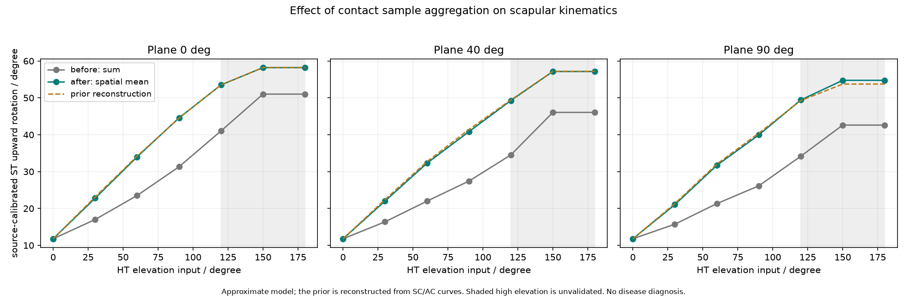
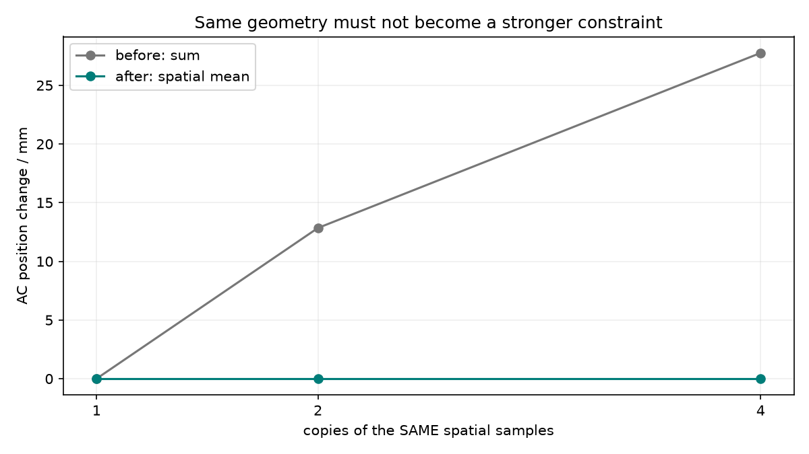

# 肩が詰まって見える挙動の再監査：拘束点数への依存を修正

2026-11-26追記。受領した8枚は画面上の表示がv0.75.0。片腕・両腕の挙上、側面の胸筋膨隆、背面の肩甲帯の不自然さの再現例として確認した。「四十肩のよう」という表現は動きの印象として扱い、病態再現・医学的診断を行っていない。写真から正確な関節角を復元したとはしない。[写真の識別情報](validation/v076/contact-rms/submitted-photos.json)。

以下は**未公開v0.76の6c5ed7cを再監査して発見した別の数値問題**。v0.75写真のすべての原因が、この式だったと読み替えない。v0.75の中心ずれ・段階補正の問題は従来の監査記録を参照する。

## 発見した問題

肩甲骨肋骨面の評価点は、占有グリッドセルから選ぶ空間サンプルである。独立した実測値ではない。しかし従来のv0.76は点ごとの離隔誤差の二乗を合計し、点数Nが増えるほど文献由来のSC/AC priorに対して拘束が強くなる式になっていた。同じ点を均一に2倍・4倍に複製するだけで、同じ入力姿勢の骨が変わった。

固定24反復、側方120°、同一の62点を複製した例：

|点数|修正前のST上方回旋|62点からのAC位置差|
|---|---:|---:|
|62|41.024°|0mm|
|124（同じ点を2回）|29.672°|12.840mm|
|248（同じ点を4回）|21.845°|27.754mm|

幾何形状や情報が増えていないのに姿勢が変わるため、これは離散化の数値不具合である。骨メッシュ・付着・医学的可動域の変化ではない。

## 修正

旧式：`角度prior損失 + Σᵢ rᵢ²`。

修正式：`角度prior損失 + (1/N) Σᵢ rᵢ²`。

最小二乗へ渡す離隔残差を`1/sqrt(N)`で正規化する。曲面の範囲外ペナルティも同じ空間平均にする。均一にk回複製すると、分子・分母がともにk倍になり、同じ目的関数となる。旧v0.61の幾何評価も平均損失を返しており、その空間評価という意味を共通ソルバーで保つ。

角度曲線・priorの標準化尺度・離隔の許容値・可動域・筋の厚み・筋別係数は変更していない。ただし、以前はN倍されていた接触項とpriorの相対寄与が変わるため、骨姿勢と筋形状は再検証する。物理的な関節剛性を同定した修正ではない。

これは均一セルの平均近似であり、任意の非均一サンプル分布や真の骨表面積に対する積分を保証しない。将来は骨表面の面積重み・実骨距離へ置き換える。今回の均一複製不変性だけを全メッシュ解像度への不変性と呼ばない。

## 数値結果

- 21姿勢×2倍／4倍複製で、AC/GH位置差は最大約1.23e−12mm。目的関数の一致も検査。
- 前方120°の例：ST上方回旋34.160°→49.428°。拘束を外したSC/AC priorからの再構成は49.263°。これは同じアトラス推定軸におけるモデル比較であり、健常者の実測ST角や医学的正常値の合格ではない。
- 実データ62点、0/40/90°面、1°刻み543姿勢：近似曲面の最小離隔2.9678mm、最大28.8551mm、曲面範囲外0点。実骨面全体の交差・正常な軟部組織厚さを確認した結果ではない。
- CPU24対48反復の剛体差の保守的評価は最大約0.000010mm。新しい関節補間を再生成し、9,720点でCPUとの差の保守的評価は最大0.36726mm。1mmの閾値は変更していない。
- 30本のオフライン試験が通過。新規試験は同じ空間サンプルの複製不変性、実際の骨フレームからのST角の再構成、HT角度と入力の一致を検査する。疾病分類・筋活動率・筋力はnull。

診断API `window.__labShoulderV076().motion`へ、肩甲胸郭の回旋・上方回旋・後傾、基準姿勢との差、拘束前との差、上腕骨軸と肩甲骨軸の角度を追加。3D角度の寄与を単純加算した2:1比率とはしない。





再現：`node tests/v076-contact-quadrature.mjs`、`node scripts/calibration/audit-shoulder-motion.mjs`。旧ソルバーはGitの6c5ed7cから別VMへ読み、現行版と混在させず比較する。新しいソルバー署名を導入し、旧事前計算の無条件再利用を防ぐ。旧補間の検証JSONはvalidation/v076/pre-contact-rmsへ保存した。

## 実メッシュ・画像・公開判断

修正前6c5ed7cと修正後を、側方120°・前方120°・両腕180°＋首30°、正面・側面・背面、骨格のみ／全筋の36画像で比較。全18組で入力・カメラを一致させ、僧帽筋・広背筋・頸部を含む全筋を表示した。カメラには双方共通の1.2倍の余白を設け、前回の指先が切れる問題を避けた。写真の正確な入力角度の復元ではなく、同条件のコード変更比較である。[画像比較](validation/v076/contact-rms/COMPARISON.md)。骨格の回旋は変化したが、大胸筋の前方膨隆や筋の局所破綻は残る。

実アトラスの3°順逆掃引・刻み細分・頭部ドラッグ・左右独立性・GPU読み戻しを再実行。GPU18,413点のCPU差は最大0.002771mm、復帰誤差0mm。最大サンプル移動は**19.389→21.165mm/3°へ悪化**。新しい最大例は肩甲挙筋v58Levator、頂点78、前方90→93°。刻みを0.375°へ細分すると約0.161倍へ減るため、有限ジャンプとは分ける。

優先6区分・7姿勢の最大辺長比は**13.570→18.380**、最大面積比は**295.214→1360.142**へ悪化した。閉鎖体積・真の反転・骨／筋の新規交差は引き続き評価不能／未計測。数値集約の不具合を直したことを全体の形状改善とは判定しない。

**次に分離すべき旧処理：** index.htmlの`v58Parse → v61SelectWeights → shoulderPoseFor`では、13姿勢の局所辺長損失から筋の基準ウェイトを選び、その値を共通エンジンへ登録する。骨格モデルを変更すると基準ウェイトも再選択され得る。従って筋画像・形状指標の変化を、同じ基準ウェイトでの骨格変更だけの効果とは見なせない。骨ローカル付着の定義・基準材料データと、姿勢ごとの運動・変形を分離し、前後のウェイトを直接保存・照合して切り分ける必要がある。一律薄化や筋別の新しい補正係数は追加していない。

点数依存の修正は作業ブランチへ保存するが、全体の採用・公開判断は保留。main／Pagesへは反映していない。旧6c5ed7cとその検証データを保存し、医学的な正常動作の合格・四十肩の治療／再現とはしない。

再実行コマンド（Chromeパス・ATLAS_CACHEは環境に合わせる）：

```sh
node scripts/calibration/build-shoulder-field.mjs tests/fixtures/shoulder-v076-field-calibration.json
npm test
QA_NUMERIC_ONLY=1 QA_OUTPUT=test-results/v076-contact-rms-final node tests/browser-v073.mjs
QA_REFERENCE=6c5ed7ce68aaea64da458e6ba5b58bbbb748df68 QA_BASE_LABEL=before-sum QA_CURRENT_LABEL=after-mean QA_POSE_SET=contact QA_VIEWS=front,side,back QA_CAMERA_MARGIN=1.2 QA_OUTPUT=test-results/v076-contact-rms-compare node tests/browser-v076-compare.mjs
```

入力ソース33ファイルのSHA256を監査開始時と終了時に照合した。最新の生データ・フィクスチャ・比較条件はvalidation/v076/contact-rms以下。
