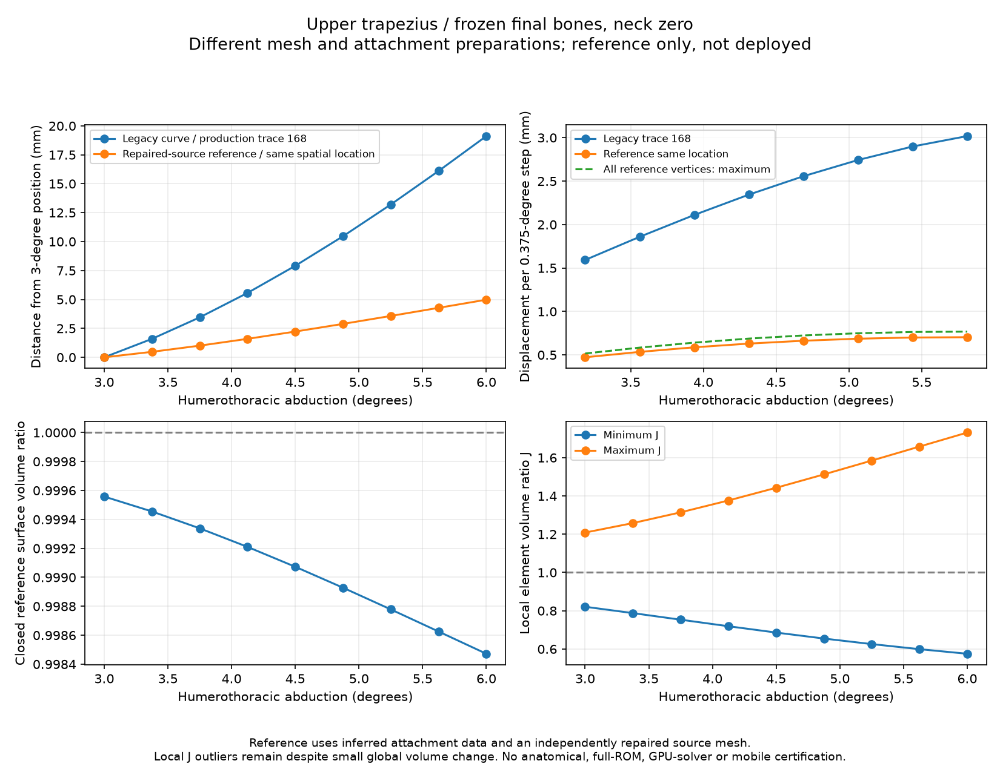

# v0.76：共通接触処理・原型の連続変形参照

2026-11-27。**参照実装の追加であり、製品への統合・v0.76の公開は未完了。** 公開はv0.75.0 / c81256f653c04c042ed917279b4fa3e4bde0f841を維持する。以下の結果で全筋・全可動域・医学的正確性の合格とはしない。

## 共通の接触拘束

`contact_potential.py` は、固定点を動かさず、元メッシュの面積求積で重み付けした片側接触を追加する。実際の閉鎖骨面の距離・外向き勾配から接平面を更新し、材料エネルギーと同時に解く。最適化内は正J・下降方向・Armijoを維持。骨内部の元からの重なりは材料点ごとに記録し、その深さの増加を評価する。全体の最大深さだけで比較しない。

ペナルティ係数の継続は数値解法であり、測定した組織定数・筋力ではない。最大増加0.1mmをサンプル接触の停止条件とした。これはユーザーの著しい新規貫通を防ぐ1mm目標に対する数値余裕で、医学的正常値ではない。固定境界がこれを妨げる場合は理由と頂点を保存して拒否し、固定解除・位置押出しで隠さない。

骨の種類は `contact-bone-sets.json` のデータへ分離。中部三角筋は肩甲骨・上腕骨、僧帽筋上部は現在の試験では鎖骨だけ。未登録筋に別の骨を流用しない。全骨・筋膜・隣接筋の接触網の完成とは区別する。独立のワールド座標監査との最大差4.18e−14mmも確認した。

## 中部三角筋：90°外転

固定範囲を誤って広げない[PLC構造](ATTACHMENT_BOUNDARIES_V076.md)を使用。骨格の最終姿勢・元表面は同じで、起始候補は骨面由来の推定である。

|検査|接触前|接触後|
|---|---:|---:|
|新規上腕骨内の最大深さ増加（頂点）|2.280994mm|0.042968mm|
|全体積比|0.99906949|0.99910709|
|固定位置からの変形誤差|0|0|
|材料セルに対する面方向警告|0|0|

接触後は全38,712頂点、116,130辺中点、77,420面重心、計232,262サンプルを両骨で検査。上腕骨への最大増加は0.057174mm（辺中点）、肩甲骨への増加は丸め誤差のみ。有限サンプルであり、全面交差や非局所自己衝突の厳密証明ではない。**元からある上腕骨内の最大深さ約4.075mmは残る。** 推定固定点の変形誤差0を、実測enthesisの位置誤差0と読み替えない。

全筋と対象筋の正面／側面／背面、各曲線／参照の12画像を取得。骨・カメラ一致、例外0、GLエラー0。同じ画面で他の肩周囲筋の不良も確認し、全体改善完了とはしていない。[原画・パネル](validation/v076/contact-reference/deltoid-90/)。

## 僧帽筋上部：原型の不良と3〜6°の連続性

元の23,209点／46,450面は閉鎖・向き整合でも、TetGenの境界回復が自己交差を検出し拒否した。13のスキップ三角形と元の番号を保存。閉鎖だけで正確な体積を算出できるとは判断しない。

別の参照データをMeshFix 0.17.2で作成。部品の除去・結合を禁止した設定で、1連結成分を維持し、23,187点／46,402面となった。元と完全同一の座標を18,921点で保持。元→候補の頂点―面距離最大0.109092mm、候補→元1.554e−5mm。**頂点サンプリングであり連続Hausdorff距離の証明ではない。** TetGenで全80,265正体積要素と元の候補表面の完全一致を確認。GPL MeshFix／AGPL TetGenはオフライン生成専用で、Web・CIの実行依存には追加しない。

以前の最大サンプルは、作業版の曲線方式の僧帽筋上部・頂点168、外転3→6°、19.116553mm。首0で骨姿勢を完全照合し、その**同じ安静時空間位置**を新参照で評価すると4.977147mm。旧点は修復候補表面の外に0.00515mmあり、安静時に選んだ境界要素を固定してアフィン延長したことも記録した。別の原型頂点を168と呼び替えていない。

0.375°刻みの9姿勢を独立に解き、旧点と同じ空間位置の最大移動0.703743mm、全23,187参照頂点の最大移動0.767703mm。全固定位置誤差0、非正要素0。これは首0・この筋・この狭い範囲の参照結果であり、現アプリの19.116553mmが公開版で修正されたという意味ではない。

**比較には修復メッシュと追加した停止候補も含む。変形アルゴリズムだけの差とはしない。** 同じ修復原型・固定領域へ既存曲線方式を再bindしたアブレーションでは3→6°最大6.177608mmまで減るが、90°体積比0.85899、150°0.77043、最大面積比33.74が残る。データの改善だけでも初期の増幅を軽減できる一方、共通写像の再設計が必要である。



3°と6°の正面／側面／背面を曲線・参照で計12画像取得。6°は3°のカメラを再利用した。比較器が元の頂点168の座標を1µm以内で再現することもassertした。原型・境界の違いを画像とJSONに記載。[3°](validation/v076/contact-reference/trapezius/visual-3/)、[6°](validation/v076/contact-reference/trapezius/visual-6/)。

## 局所体積を平均で隠さない

|姿勢|共通の数値bulk比|全体積比|局所J最小〜最大|
|---|---:|---:|---:|
|3°|30|0.99955792|0.820807〜1.208503|
|6°|30|0.99847200|0.575190〜1.731025|
|3°|3000|0.99998655|0.958039〜1.041021|
|6°|3000|0.99995294|0.869802〜1.162127|

30→100→300→1000→3000の材料ペナルティ継続を追加し、固定位置・正J・0.001mm平衡残差を維持した。同じbulk系列を全ケースで使用し、筋別の見た目係数は足していない。正規化したせん断項に対する比であり、実測材料定数でも力の推定でもない。3000でも6°の局所外れ値は約−13〜+16%残り、近似非圧縮性・離散化・付着データは未達。全体積だけで合格にしない。

冷開始の高bulk計算は高コストのまま完了せず停止し、継続法へ変更した。停止残差を緩めた高速化ではない。線形接線解は対称順序付けと後退誤差検査を使い、方向・エネルギー・Jも検査する。未収束途中状態を合格にはしない。

## 回帰試験と再現

合成入力の20 Python試験に加え、修復候補と実際の骨姿勢を1.05MBの[不変fixture](../tests/fixtures/v076-trap-upper-reference/)として保存。`tests/reference-v076-trap-upper.py` は共有ソルバを実原型の3°/6°で実行する。最大変位の回帰ガードは、指定した固定点の最大移動5.432706mm＋元のメッシュ辺長中央値0.968727mm＝6.401434mm。医学的ROMや新しい筋別係数ではない。全体積±5%はユーザーの工学目標のまま。局所Jの外れ値も出力する。

6°解から境界を安静時へ戻して再反復し、中立復帰ドリフト1.524e−11mmを確認。リセットで元座標へ置き換えた結果ではない。ただし一筋の数値参照であり、本番UIの操作試験ではない。[実行結果](validation/v076/contact-reference/trapezius/real-source-test.json)。

```sh
python -m pip install -r scripts/experimental/requirements-reference.txt
python tests/reference-v076-trap-upper.py
```

再生成は `repair-source-reference.py` → `build-volumetric-reference.py` → `export-volumetric-targets.mjs` → `prepare-source-cage.py` → `run-conforming-reference.py`。0.375°刻みは `snapshot_names.py` によりファイル名を区別し、小数の切捨て・上書きを防ぐ。元アトラス、ライセンス、修復設定とSHAはfixture metadataに保持する。

接触は次で再現する。実骨STLキャッシュと研究用trimesh/embreexが必要。

```sh
python scripts/experimental/run-cage-contact.py test-results/v076-plc-surface-refined-mid-acromial-18/reference-e90-p0-k30.npz
python scripts/experimental/audit-cage-surface-samples.py test-results/v076-plc-surface-refined-mid-acromial-18/contact/reference-e90-p0-k30.npz
```

## 公開前に残る作業

全筋・腱の移行、頭蓋骨／頸椎への複数起始の追従、全可動域と順逆・左右・複合運動、fascia/筋間滑走、元からの交差の解剖学的評価、局所体積と自己交差、GPU変形と実機30fpsが未完了。CPU参照や静止VBO描画の成功をGPU実時間実装と混同しない。

接触なしの180°数値負荷は進捗0.703733の正J途中状態で止めた。最終骨姿勢の数値補間は実際の関節角の運動ではなく、今後は実際の姿勢列と接触を結合して検証する。これを完成180°として表示・公開しない。
