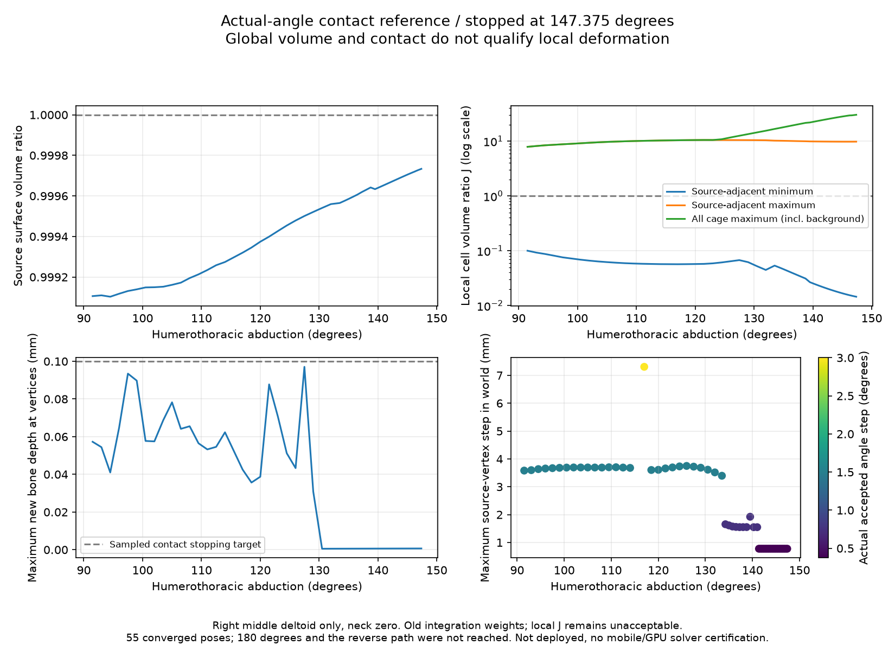

# v0.76：実関節角列・実骨距離・材料積分の再設計

2026-11-27。**未公開の参照実装。全筋・全可動域・医学的正確性の合格ではない。** [前段階](CONTACT_REFERENCE_V076.md)の90°静止接触から、実際の関節角列で接触を解く構造へ進めた。Webの既定はまだ旧曲線方式である。

## 廃止した参照処理と新構造

`actual_bone_contact.py` は、試行ごとに実閉鎖骨面の距離・外向き勾配を再計算する。古い接平面のエネルギーだけで更新を採否しない。材料と実距離の目的関数に対するArmijo、正J、固定端、0.001mm平衡残差を維持。接触接線はPSDのGauss–Newton近似で、距離曲率を含む厳密Hessianとは呼ばない。

逐次接平面だけの方式は、実距離の残差も検査すると91.125°以降の試行で未収束になった。古い試行状態は次の姿勢に混入させず保存した。解析球の独立距離式・数値微分と、実材料＋曲面接触の小規模試験で新方式を検証してから、同じ原型で再実行した。

`material_pose.py` は最終剛体姿勢と材料座標の変換を担当。複数の固定領域を個別の骨フレームへ登録でき、未登録クラスは拒否する。合成のtrunk/C0/C4/C7/scapulaと左右鏡映で独立式との一致を検証した。ただし実頸部筋の複数起始をこの参照へ移行したわけではない。`joint_path.py` は事前保存した0.375°刻みの実骨姿勢を読み、通常3°の試行を失敗時に二分する。未収束解を巻き戻し、挙上・下降の双方を扱える。最終骨へのSLERPや固定点の直線補間を実際の途中関節姿勢の代用にしない。要求範囲を縮めて成功とはしない。

## 実メッシュ：90〜147.375°の55収束姿勢

対象は右三角筋中部、外転面0°、首0°。同じ推定付着993点・1,702面、元解剖表面、PLC 3,044制御点／18,124要素を使った。初期状態は前段階の90°接触解。**0〜90°、180°、下降はこの実行では未実施・未到達。** 局所体積と積分の問題を確認し、次の未収束試行を停止した。停止処理完了後の保存最終角は147.375°である。

|独立監査|55姿勢の結果|
|---|---:|
|原型表面の全体積比|0.999103〜0.999734|
|固定点誤差|0mm|
|非正材料セル|0|
|材料セルに対する面方向警告|0|
|Float32保存後の非正制御セル|0|
|実距離の平衡残差・最大|0.0009301mm|
|骨内深さの基準からの増加・最大|0.097078mm（頂点）|
|原型表面に接するセルのJ|0.014495〜10.489311|
|背景を含む全制御セルのJ|0.014495〜30.203539|

**最後の2行が不合格の理由である。** 平均や全体積で局所破綻を隠さない。正Jは局所の向きを守るが、非局所自己衝突や解剖学的合理性の証明ではない。Float32保存は新しいGPU変形ソルバの整合試験ではない。

120°と147.375°は別のワールド座標の実骨監査も実施。120°の新規最大深さは上腕骨0.038739mm、肩甲骨は丸め誤差のみ。元からの最大約4.075mmの上腕骨内重なりは残る。指定2骨以外の接触は未評価。



120°の正面・側面・背面、全筋と対象筋の計12画像を同じ骨・カメラで取得し、両パネルを目視。例外0、GLエラー0。三角筋以外は旧曲線方式のままで、大胸筋・背部等の形状不良が残る。対象筋の外形変化だけで全体の改善完了とはしない。[原画とパネル](validation/v076/joint-contact/visual-120/)。

## 材料積分の根本誤差

従来の4点求積と親セル密度の継承は、微小セルにある原型組織の体積を見落とす場合があった。90°でJが最大だったセル229では、元の細かい体積分割との交差量0.000727713mm³に対し、旧ウェイトの等価体積は0.000048103mm³、約6.61%だった。セル15247は原型組織との交差量0で、背景の数値正則化だけがある。両者を混同しない。

`tet_intersection.py` と `integrate-material-cells.py` は、元の細かい四面体と制御セルの凸交差体積を計算する。正規化した局所座標、キャッシュした逆行列、分離面・包含の一括検査、凸包体積を使用。解像可能な薄い3次元形状はPCA座標の正規化を元に戻して積分し、形状を厚くしない。数値的に次元を確定できない接触は件数を記録する。厳密有理数の幾何計算や連続面衝突の証明ではない。

18,124セル・1,227,428候補ペアを検査し、6,985セルで正の原型体積を検出。元体積92,349.344004588mm³、交差量合計92,349.344004423mm³、相対被覆誤差1.782e−12。各元四面体の割当量も照合し、最大絶対差1.494e−7mm³、絶対差の合計1.648e−7mm³。検査失敗時は置換ウェイトを出力しない。別の三重積による元要素ごとの監査では、交差量0の元要素は0件、相対誤差最大は0.01361%（体積0.001098mm³の要素41706）。99.9%分位は約2e−13だが、最大値も記録する。[独立被覆監査](validation/v076/joint-contact/material-coverage-audit.json)。

**形状・固定領域・骨姿勢・bulk・停止条件は変更しない。背景の元の正則化密度も親セルから厳密に保持した。** 筋別の修正係数ではない。`reequilibrate-contact.py` で変数を分離して検証した。同じ初期解から同じ実距離の目的関数・bulk・停止条件で、旧積分の対照と新積分をそれぞれ再収束させた。

|90°外転|旧積分の対照|原型交差量による積分|
|---|---:|---:|
|原型表面に接するセルのJ|0.107479〜7.572327|0.252048〜3.273161|
|セル229のJ|7.572327|2.139242|
|全体積比|0.99910709|0.99889725|
|新規骨内の最大深さ増加|0.042968mm|0.041232mm|
|固定誤差|丸め誤差のみ|丸め誤差のみ|
|面方向警告|0|0|

改善は確認できるが、局所Jはまだ不合格。[比較数値](validation/v076/joint-contact/integration-comparison.json)。原型形状・付着・最終骨・材料比を固定した比較であり、全体積だけで採用していない。旧接触画像の保存形状は対照解とFloat32位置が一致することも別途確認した。新積分も同じカメラで12画像を取得し、旧／新の両パネルを目視。形状差は小さく、局所体積の改善を全体の見た目の解決とはしていない。[積分変更の同条件画像](validation/v076/joint-contact/integration-visual-90/)。

## 共通材料比の感度と短い往復

同じ交差積分・骨接触・固定・0.001mm平衡停止条件で、bulk30→100→300→1000→3000を順に収束させた。以前の僧帽筋参照と同じ共通系列で、筋別の見た目係数ではない。正規化した材料比であり、実測材料定数・活動率・筋力ではない。

|bulk比|符号付き表面体積比|正の原型交差量を持つセルのJ|
|---|---:|---:|
|30|0.99889725|0.252048〜4.321119|
|100|0.99961351|0.371487〜3.219107|
|300|0.99985591|0.420162〜2.603896|
|1000|0.99995042|0.422414〜1.787761|
|3000|0.99998315|0.450671〜1.627359|

交差量が正の全セルをサイズ閾値なしで評価する。これは表面に接するセルだけの範囲とは異なり、内部も含む。背景セルを含む最大値や表面隣接範囲も個別JSONに保持した。**3000でも局所圧縮・膨張は未達。全体積やbulkの増加を合格条件の代用にしない。** 表面の符号付き体積と交差量×Jの積分体積は各段階で4e−15以内の比差だが、非局所自己衝突の証明ではない。

初期解から指標を引き継ぐ旧レポート処理を廃止し、`audit-reference-snapshot.py` で保存頂点から辺・面積・J・固定・体積を再計算した。再計算は新しい平衡計算を実施したことにはしない。原レポートとNPZのSHAも残す。

bulk3000で実関節90→90.375→90°の2ステップを実行。両ステップが実距離・正J・平衡を満たし、同じ90°への最大復帰差2.254e−12mm、最大ステップ移動0.895881mm。元の形状へのリセットはしていない。ただし狭い一筋の往復であり、中立復帰・全可動域・頸部・左右の検証の代用ではない。[往復記録](validation/v076/joint-contact/corrected-return.json)。

## 再現と保存

[数値・入力SHA](validation/v076/joint-contact/)に停止姿勢列、独立監査、画像、積分結果を保存。大きい制御メッシュ・解NPZは `test-results/`。元のSTLキャッシュと研究依存は `scripts/calibration/requirements.txt`。代数回帰は `requirements-reference.txt` のみで実行でき、追加3試験を含め23件となった。

```sh
python scripts/experimental/test-joint-path.py
python scripts/experimental/test-actual-bone-contact.py
python scripts/experimental/test-tet-intersection.py
python scripts/experimental/integrate-material-cells.py \
  test-results/v076-plc-surface-refined-mid-acromial-18 \
  test-results/v076-acromial-volume-input/deltoid-mid-tetrahedra.npz \
  test-results/v076-mid-intersection-integrated-v3 \
  test-results/v076-plc-mid-acromial-18
python scripts/experimental/reequilibrate-contact.py \
  test-results/v076-mid-intersection-integrated-v3 \
  test-results/v076-plc-surface-refined-mid-acromial-18/contact/reference-e90-p0-k30.npz
```

公開には、局所体積・自己接触・固定領域の解剖照合、全筋・腱の移行、全可動域・順逆・左右・頸部・複合運動、CPU/GPUの実時間実装、スマートフォン30fpsが残る。実装と検証を継続し、この途中結果を公開可能な完成版とはしない。
