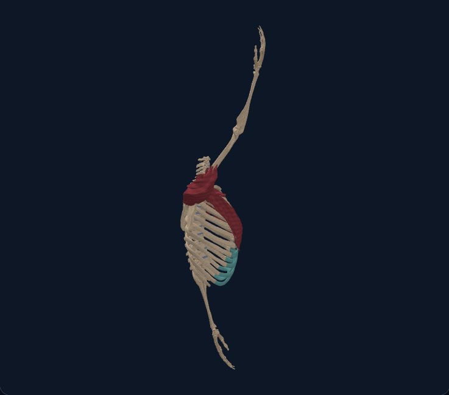

# v0.73 検証・公開判定

**開発版。mainへの反映およびGitHub Pagesのv0.73.0公開は保留。** 付着点と数値計算の試験だけで、局所形状・接触・全筋移行の合格を宣言しない。

## 再現環境

2026-11-25、macOS、Node.js v26.13.0。CIはNode.js 22。作業コミット`b3511f2`の[GitHub Actions](https://github.com/szkawaharu/upper-limb-anatomy-lab/actions/runs/45635126944)でも23本全て通過。Chrome/Playwrightを使用し、描画を再現するためSwiftShaderを明示した。物理GPU／スマートフォン実機の30fps判定ではない。

```bash
npm ci
npm test
npm run serve
CHROME_PATH="/path/to/chrome" npm run test:browser
node scripts/verify-cervical-atlas.mjs /path/to/cached/stl
node tests/v064-atlas.mjs /path/to/cached/stl
```

## 変更前の監査

- 現行main `025b768`を保存ブランチへpush。
- 既存21オフライン試験を変更前に実行。15本通過、6本はハーネス起因の失敗。別途データが必要なv0.64アトラス試験を後から実行。
- エラーは古い肩拘束依存、イベント用DOMスタブ不足、読み込みのyieldを解決しないタイマースタブ、古いバージョン文字列／骨運動期待値だった。幾何閾値は緩和せず修復。
- 実アトラス79胸郭部品・17筋区分を取得し、基本肢位／90・150・180°／前方挙上の正面・側面・背面を保存。基準の描画CPU時間は`validation/v073/baseline-browser.json`。これはGPU待ち込みの実fpsではない。
- `baseline/`の画像は保存版の実描画。新旧の自動フィットは同一固定カメラ条件ではないため、これだけで形状改善量を定量比較しない。

## 自動試験の適用範囲

`npm test`は既存21本と追加2本、計23エントリーポイントを実行する。合成共通エンジンは0–180°を1°刻み、頸椎は−75–75°を1°刻みで確認。付着点固定、有限値、戻り、中立位、局所対角倍率、腱側の断面、開放メッシュ排除、骨変換検証を含む。過去の220項目統合ハーネスも通過した。

ブラウザ試験は17筋の実アトラス、0/30/60/90/120/150/180°の側方・前方挙上、3°刻みの順方向・逆方向、首の±15/30/45/60/75°、両腕挙上中の首独立操作、前面・側面・背面の頭部ドラッグを検証する。WebGL2 transform feedbackにより、WebGL1と同じ本番頂点カーネルを実行してCPUとの位置差を読み戻す。数値掃引時は描画要求を抑止し、描画性能試験と混同しない。

## 形状監査と保留項目

最初の実姿勢監査では、高挙上時の最大辺長比46.878倍を検出した。固定付着点の最大誤差は約0.000022mmで、付着が良くても局所形状が破綻し得ることを確認した。対象6メッシュは閉鎖条件不成立で、体積は全て評価不能。中間結果は`intermediate/before-coordinate-regularization.json`。

基準材料座標をメッシュ接続に沿って正則化する共通処理を追加した。単純化した180°の診断では大胸筋胸肋部・腹部・三角筋後部の最大辺長比がそれぞれ約32→8、36→10、45→12へ下がったが、これは最終骨姿勢・接触を用いた合格値ではない。筋別係数を追加して解決したとは扱わない。

未評価は`null`として返す：正確な交差、局所反転、骨面距離、真の体積ヤコビアン。局所面積／辺長の最大と最小、制限された頂点数、無効フレーム数、閉鎖性を保存する。平均のみで合否を決めない。

全95経路アダプターの材料写像への移行、基準と新規の骨／筋間交差、頸部付着位置、全手指・弓道複合姿勢、実機性能、固定カメラの完全な新旧比較は残る。詳細は[既知の問題](KNOWN_ISSUES_V073.md)を参照。

## 今回確定した数値（正則化・部分付着チャート追加後）

|検証|結果|解釈|
|---|---:|---|
|実メッシュCPU/GPU読戻し|18,413頂点、最大差0.002845mm|GPU対応写像の位置整合。全頂点・実機GPUの保証ではない。|
|3°刻みの順逆掃引の復帰誤差|0mm|同一姿勢の数値ドリフトなし。|
|掃引中の最大サンプル頂点変位|53.6984mm / 3°|局所経路・フレームの連続性は未合格。|
|大胸筋／三角筋6区分の最大辺長比|16.0288|初回46.878から改善したが、大きな局所変形が残る。|
|同6区分の付着点変換最大誤差|約0.0000222mm|登録済み領域と計算上の骨変換との差。付着位置の解剖精度ではない。|
|同6区分の閉鎖体積|全て評価不能|±5%に合格したとは扱わない。|
|頭部直接ドラッグ|前・側・後面で±25°|腕の設定とカメラ角が変化しないことをDOMイベントで確認。|
|頭部取得|頭蓋22、頸部筋6|元バイナリ28個のSHA一致を確認。|
|数値ブラウザ試験のpage error|0|描画負荷を抑止した数値・操作試験。fpsではない。|

原データ：[`current/browser-numeric.json`](validation/v073/current/browser-numeric.json)、[`current/priority-mesh-audit.json`](validation/v073/current/priority-mesh-audit.json)。17筋区分すべての共通チャート生成を確認した。小菱形筋は部分付着チャートであり、固定停止データの照合は残る。

GPU読戻しには6頸部筋（胸鎖乳突筋の2骨混合起始を含む）も追加した。数値試験では描画を抑止してCPU参照とGPU写像を分離して検証した。全シーンの実描画・実機性能の合格とは区別する。

公開サイトはHTTP 200でv0.72.0を表示。mainは`025b768888b31bb89713e13a28e81d77c6f7417a`。GitHub Pages APIは既存状態`errored`、公開元`main:/`を返した。v0.73の公開更新は実施していない。

## 同一姿勢・同一カメラの視覚比較

保存版v0.72.0と今回のCPU参照を、基本肢位／右前方150°・左中立の正面・側面・背面で比較した。頭部は両版とも非表示、大胸筋3区分と三角筋3区分に表示を絞り、他筋を両方で同様に非表示にした。カメラyaw・pitch・zoom・targetの完全一致を自動確認し、12枚を取得、page errorは0。今回の画像はCPU参照変形をWebGLで描画したもので、モバイルGPUでの実描画性能の比較ではない。

元データ：[比較条件](validation/v073/comparison/comparison.json)。全場面の比較完了を意味しない。側面の膨隆と局所変形は残っており、解決済みとは判定しない。

|v0.72.0 保存版・前方150°側面|v0.73 開発版CPU参照・同一条件|
|---|---|
|||

[頭蓋・頸部筋の中立位読み込み確認](validation/v073/current/head-neutral-loading-check.png)も保存。これは小菱形筋の部分チャート修正前の読み込み確認画像で、中立位の頭部表示を確認するための資料である。
