# 同条件画像比較 — 形状は未合格

全64画像を原寸PNGで保存。同じUI入力・カメラであり、同一の実骨姿勢ではない（中立校正が異なる）。全筋モードは僧帽筋・広背筋のマスター表示と頸部筋を含め全スイッチON。初期OFFの背部筋が含まれなかった初回画像は置き換えた。

[全条件JSON](comparison/comparison.json)／[ローカルHTTP配信で切替表示](comparison/index.html)／[検証本文](../../VALIDATION_V076.md)

|条件|v0.75基準|v0.76作業版|
|---|---|---|
|安静・骨格／正面|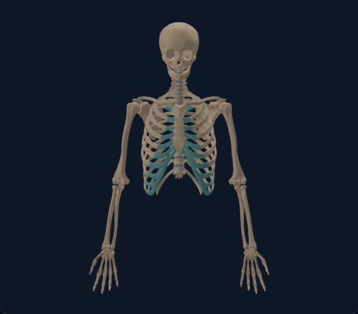|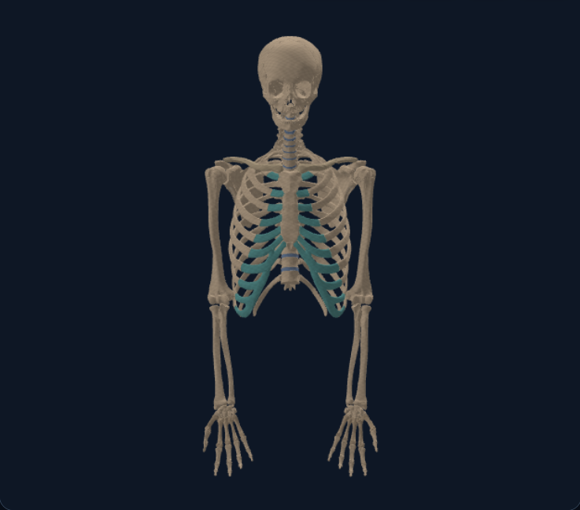|
|安静・筋／側面|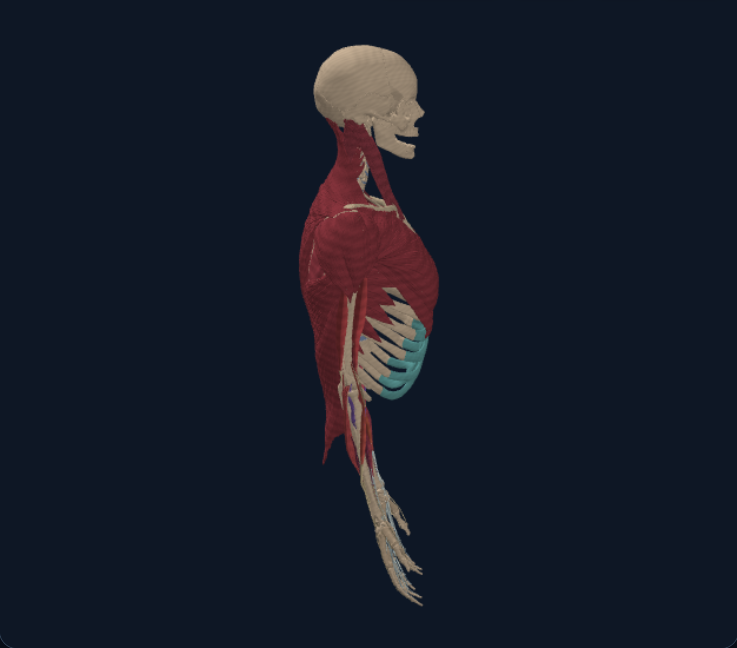|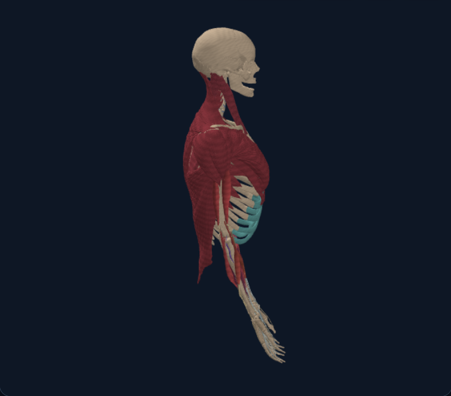|
|側方90°・骨格／背面|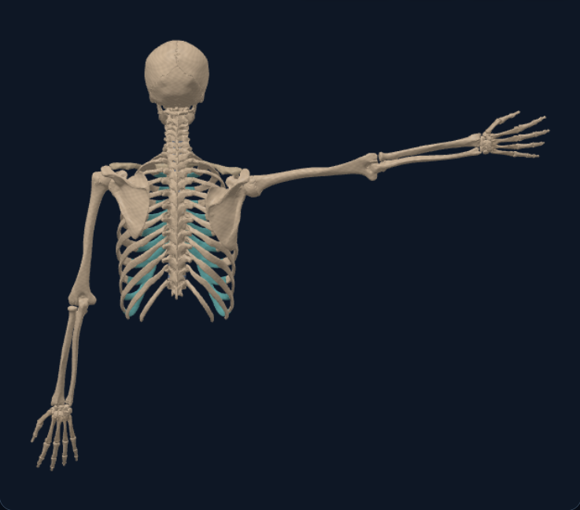|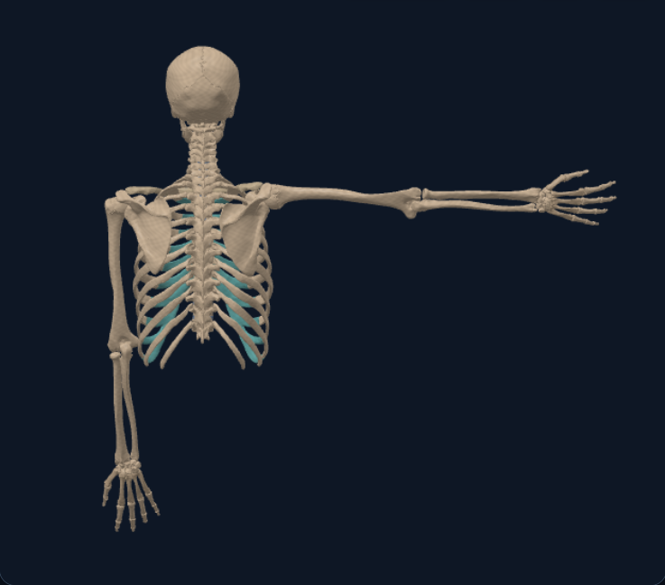|
|側方90°・全筋／背面|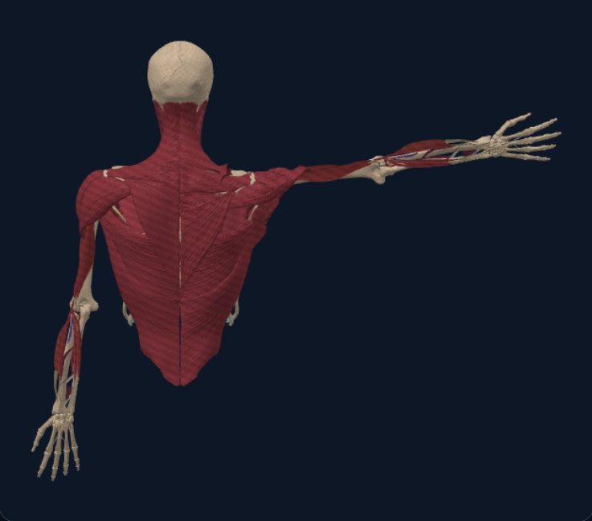|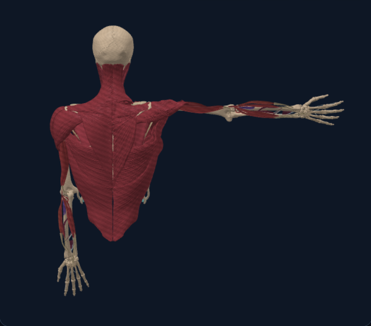|
|前方150°・骨格／側面|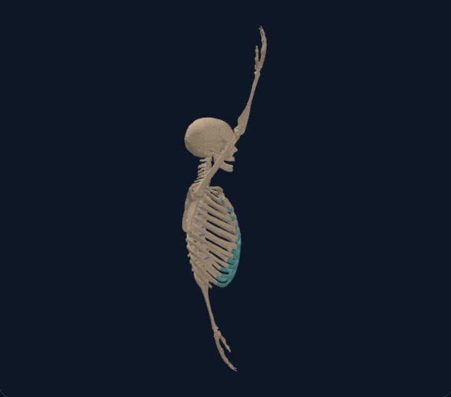|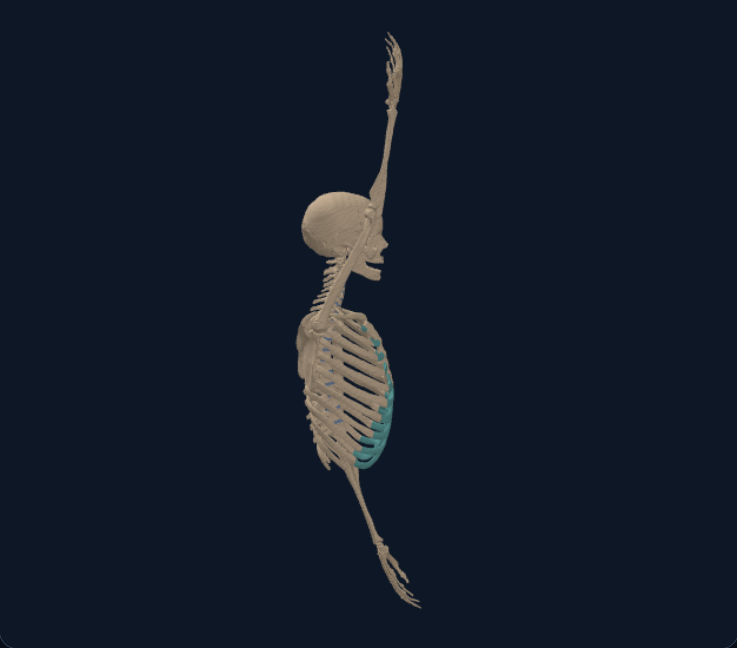|
|前方150°・全筋／側面|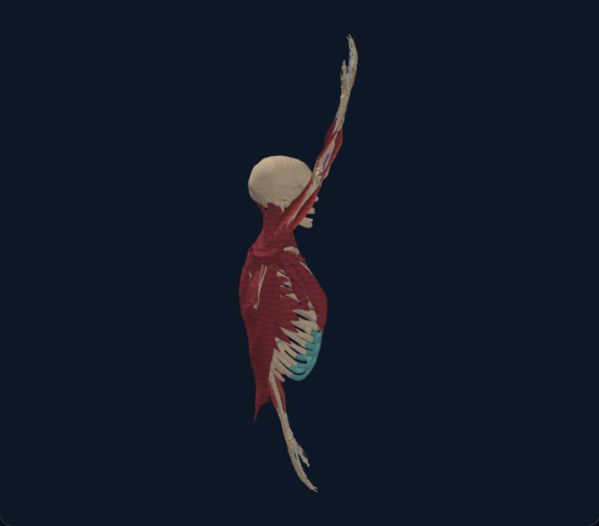|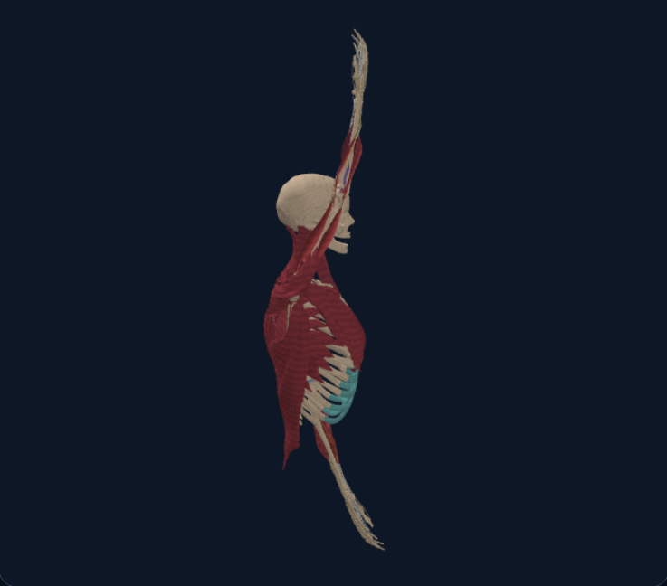|
|非対称・骨格／正面|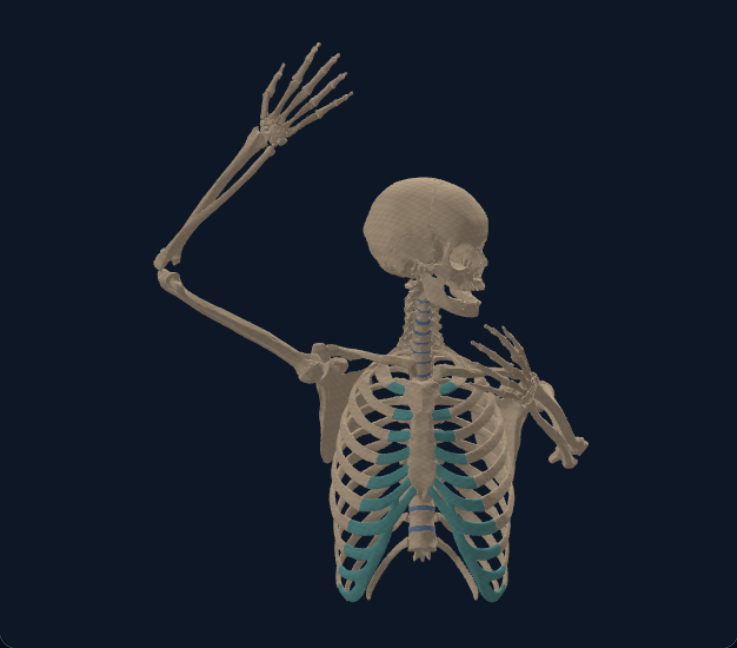|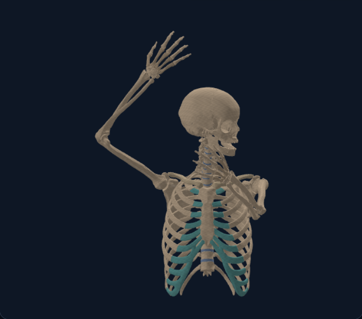|
|非対称・全筋／斜め|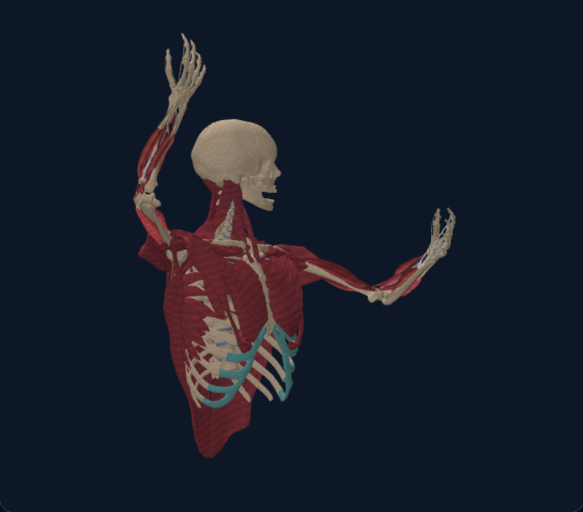|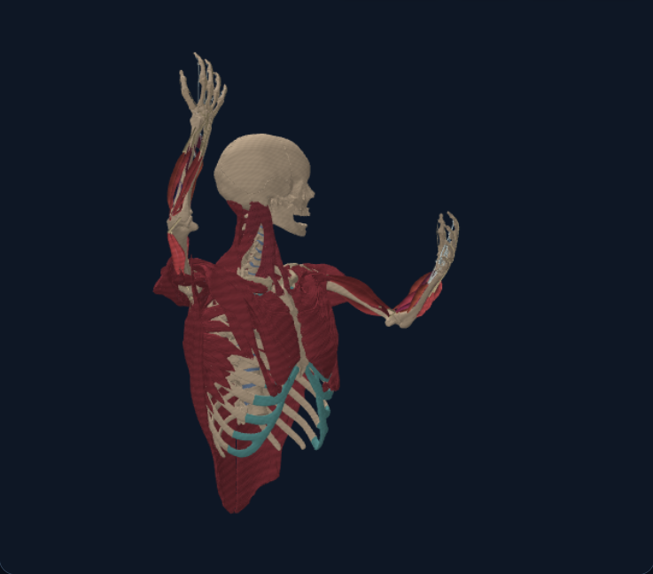|

全方向の一覧：

- [安静](comparison/contact-neutral.png)
- [側方90°](comparison/contact-side90.png)
- [前方150°](comparison/contact-front150.png)
- [非対称・首60°](comparison/contact-asymmetric.png)

前方150°の新版では指先が画面上端に達する。肩甲帯は可視だが、手指全体の画像判定にはこのフレームを使わない。次回は両版の境界を含む共通カメラを事前に求める。これを全手指の検証完了と扱わない。
