# 接触集約の修正前後 — 形状は不合格

左：6c5ed7c（残差の合計）。右：空間平均の追加修正。同じ関節入力・カメラ、双方共通の1.2倍の余白。骨格のみ／全筋（背部・頸部を含む全スイッチON）で比較。写真の正確な角度の復元ではない。

[全36画像の条件JSON](comparison/comparison.json)／[原因・採否](../../../CONTACT_AGGREGATION_V076.md)

|条件|修正前|修正後|
|---|---|---|
|側方120° bones / back|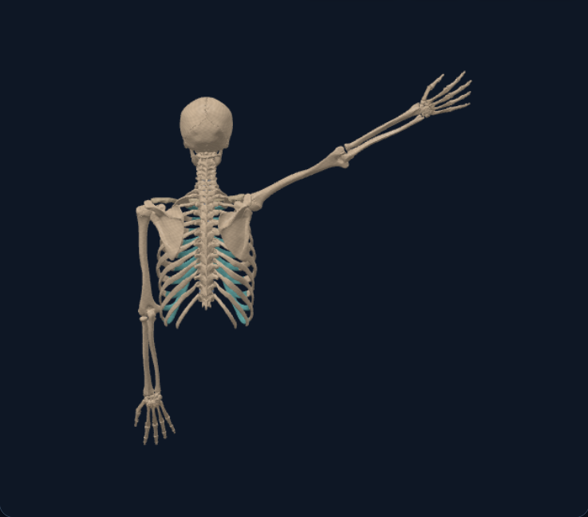|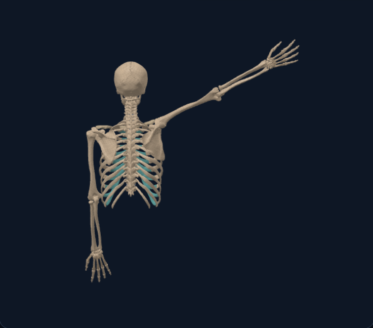|
|側方120° muscles / side|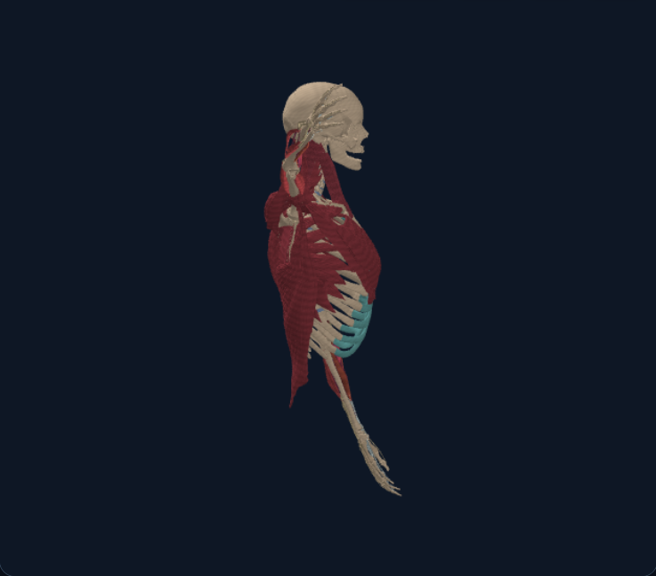|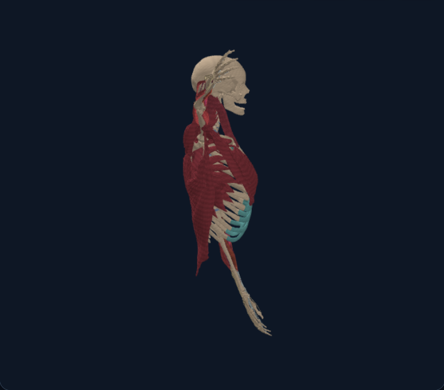|
|前方120° bones / back||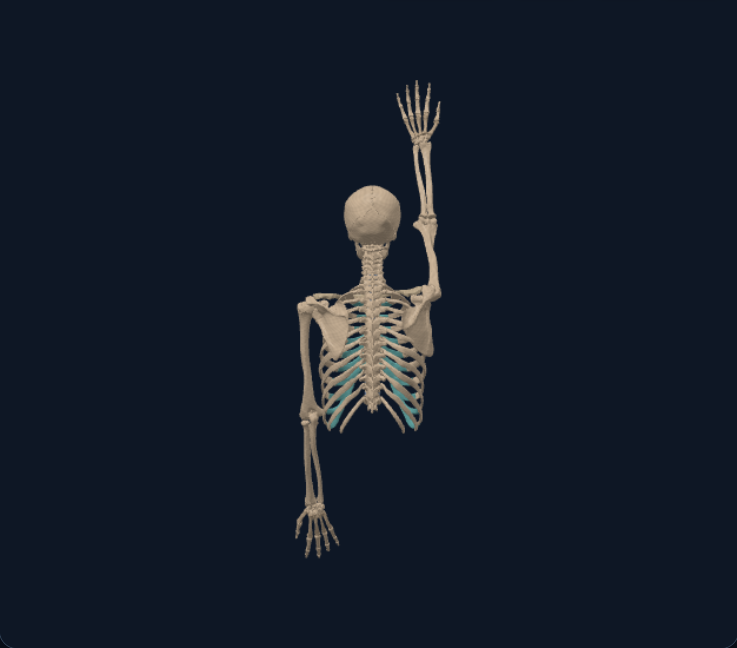|
|前方120° muscles / side|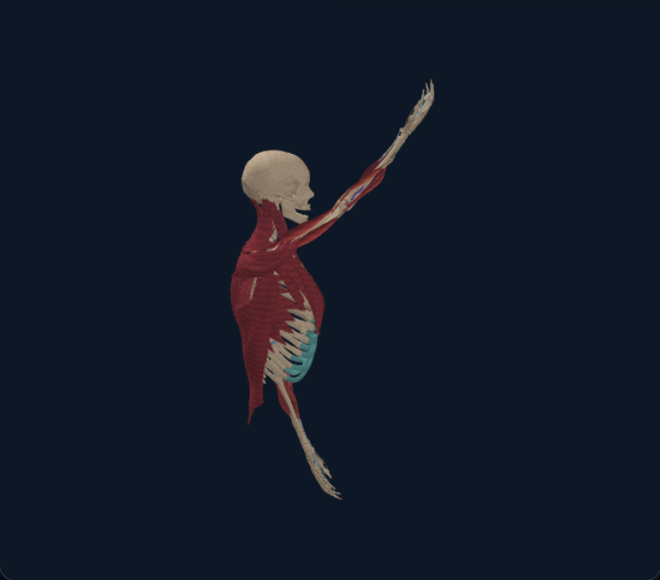|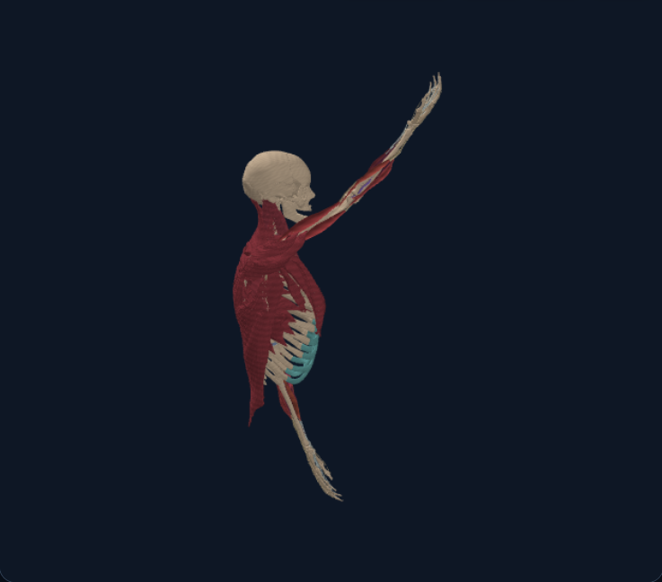|
|両腕180°・首30° bones / back|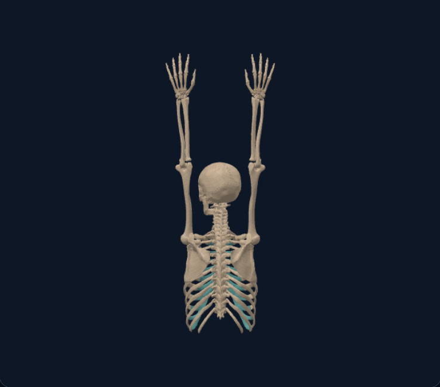|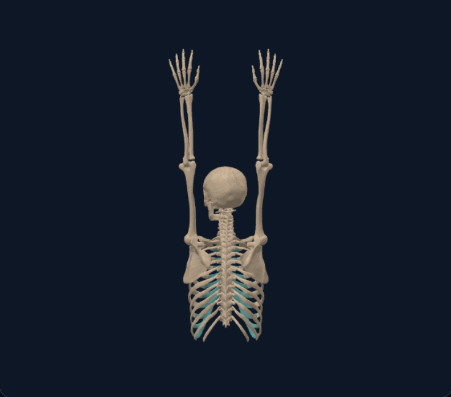|
|両腕180°・首30° muscles / side|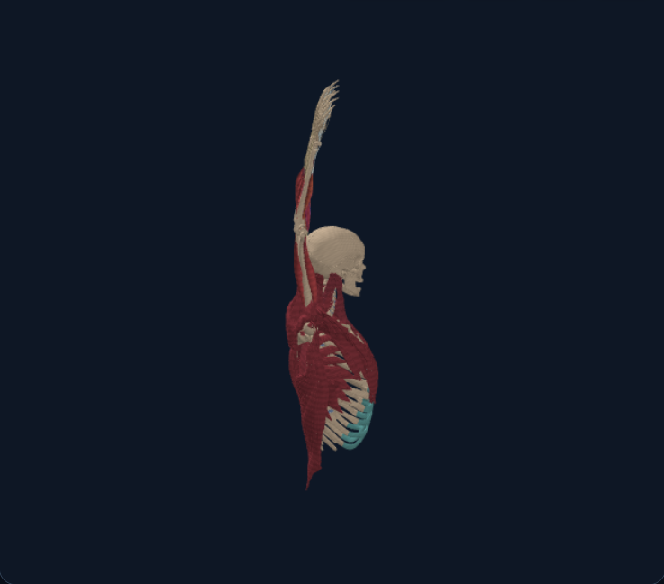|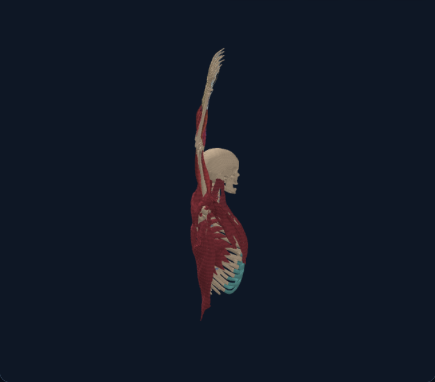|

全方向一覧：

- [側方120°](comparison/contact-side120.png)
- [前方120°](comparison/contact-front120.png)
- [両腕180°・首30°](comparison/contact-both180.png)

肩甲骨の回旋量は変わったが、大胸筋の膨隆・筋の局所形状は未達。基準ウェイトの選択も骨格計算に依存しており、筋画像の差を固定ウェイトでの骨格変更だけの効果とは見なさない。高挙上域は文献の実測範囲外の延長を含む。
